# KYC Backend Documentation & Function Guide

This document provides a comprehensive architectural breakdown of the functions, database models, middleware guards, routing layers, and wiring of the KYC Verification backend. It covers both the **Applicant Verification Pipeline** and the **Admin Intelligence & Audit Logging Engine**.

---

## 🏗️ Architectural Overview & Wiring

The KYC backend is structured as an Express and Node.js application using MongoDB (via Mongoose) as the persistent store. It integrates with external services for optical character recognition (OCR) and facial recognition, while maintaining privacy-preserving records and an append-only audit trail:

- **OCR Engine**: Extracts Aadhaar card data (Full Name and Aadhaar Number) using the [Google Gemini 2.5 Flash API](https://ai.google.dev/) (with fallback to the [Google Cloud Vision API](https://cloud.google.com/vision/) or a Mock Mode).
- **Face Recognition Engine**: Automates face detection, cropping, and biometric comparison using the [Face++ APIs](https://www.faceplusplus.com/).
- **Challenge Verification**: Executes client-side physical activity validation using MediaPipe, and processes the outcome on the backend with automated retry loops.
- **Privacy & PII Protection**: Hashes Aadhaar digits using salted SHA-256 (`sha256(PEPPER:digits)`) and masks output strings (`XXXX XXXX 1234`). Zero plaintext Aadhaar numbers are stored in MongoDB.
- **Audit Logging Engine**: Records lifecycle milestones asynchronously into a dedicated `AuditEvent` collection via `auditService.logEvent()`.
- **Admin Intelligence Layer**: Exposes protected administrative APIs guarded by constant-time bearer token validation (`adminAuth.js`), serving aggregation-driven metrics and audit histories.

### Data Flow & Wiring Diagram

```mermaid
graph TD
    Client["Applicant Browser"]
    Admin["Admin / Compliance Dashboard"]
    
    subgraph PublicRoutes["Public KYC Layer (kycRoutes.js)"]
        R_Upload["POST /api/upload-aadhaar"]
        R_Session["GET /api/session/:sessionId"]
        R_VerifyFace["POST /api/verify-face"]
        R_VerifyChallenge["POST /api/verify-challenge"]
        R_Result["GET /api/result/:sessionId"]
        
        C_Upload["kycController.uploadAadhaar"]
        C_Session["kycController.getSession"]
        C_VerifyFace["kycController.verifyFace"]
        C_VerifyChallenge["kycController.verifyChallenge"]
        C_Result["kycController.getResult"]
    end

    subgraph AdminRoutes["Admin Intelligence Layer (adminRoutes.js)"]
        Auth_Guard["adminAuth (Timing-Safe Bearer Check)"]
        R_AdminVerify["GET /api/admin/verify"]
        R_AdminList["GET /api/admin/verifications"]
        R_AdminDetail["GET /api/admin/verifications/:sessionId"]
        R_AdminStats["GET /api/admin/stats"]

        C_AdminVerify["adminController.verifyToken"]
        C_AdminList["adminController.listVerifications"]
        C_AdminDetail["adminController.getVerificationDetail"]
        C_AdminStats["adminController.getStats (Aggregation)"]
    end

    subgraph Services["Services & Utilities"]
        S_OCR["ocrService.extractAadhaarData"]
        S_FaceDetect["faceService.detectAndCropFace"]
        S_FaceCompare["faceService.compareFaces"]
        S_Audit["auditService.logEvent"]
    end

    subgraph Storage["Persistent Storage & AI Cloud"]
        DB_Sessions[("MongoDB: sessions")]
        DB_Audit[("MongoDB: auditevents")]
        Gemini["Google Gemini 2.5 Flash / Vision API"]
        FacePP["Face++ Detect & Compare APIs"]
    end

    Client --> R_Upload
    R_Upload --> C_Upload
    C_Upload --> S_OCR --> Gemini
    C_Upload --> S_FaceDetect --> FacePP
    C_Upload --> DB_Sessions
    C_Upload --> S_Audit --> DB_Audit

    Client --> R_Session --> C_Session --> DB_Sessions

    Client --> R_VerifyFace --> C_VerifyFace
    C_VerifyFace --> S_FaceCompare --> FacePP
    C_VerifyFace --> DB_Sessions
    C_VerifyFace --> S_Audit --> DB_Audit

    Client --> R_VerifyChallenge --> C_VerifyChallenge --> DB_Sessions
    C_VerifyChallenge --> S_Audit --> DB_Audit

    Client --> R_Result --> C_Result --> DB_Sessions

    Admin --> Auth_Guard
    Auth_Guard --> R_AdminVerify --> C_AdminVerify
    Auth_Guard --> R_AdminList --> C_AdminList --> DB_Sessions
    Auth_Guard --> R_AdminDetail --> C_AdminDetail --> DB_Sessions & DB_Audit
    Auth_Guard --> R_AdminStats --> C_AdminStats --> DB_Sessions & DB_Audit
```



---

## 🗂️ Detailed File & Function Explanations

---

### 1. Main Entry Point: [server.js](file:///C:/Users/Aryan%20Anand/OneDrive/Desktop/KYC/backend/server.js)

The application driver configuring middleware, database connectivity, routing mounts, upload folder scaffolding, and the periodic cleanup worker.

#### ⚙️ Mechanics & Mounted Endpoints
- **Middleware**: CORS, JSON body parser with 10MB limit (for webcam selfie base64 payloads), URL-encoded parser, and static serving of `/uploads`.
- **Database**: Boots MongoDB connection via `config/db.js`.
- **Public Routes**: Mounts KYC endpoints under `/api` via `routes/kycRoutes.js`.
- **Admin Routes**: Mounts protected administrative endpoints under `/api/admin` via `routes/adminRoutes.js`.
- **Health Probe**: Exposes `GET /health` responding with `{ status: "OK", timestamp: "..." }`.

#### ⚙️ Background Routines
##### A. `createUploadDirs`
- Synchronously ensures that directory paths `uploads`, `uploads/aadhaar`, and `uploads/selfies` exist on the file system before requests are accepted.

##### B. Session Expiry & Media Purge Interval
- Runs every 2 minutes (`2 * 60 * 1000` ms).
- Queries `Session` documents where status is `PENDING` or `FACE_VERIFIED` and `createdAt` is older than 10 minutes.
- Transitions status to `EXPIRED`, sets `completedAt`, persists updates, and logs an `AuditEvent` of type `SESSION_EXPIRED`.
- Deletes all associated biometric media on disk (`aadhaarImagePath`, `aadhaarFacePath`, `selfieImagePath`, and challenge frames).

---

### 2. Database Connection: [config/db.js](file:///C:/Users/Aryan%20Anand/OneDrive/Desktop/KYC/backend/config/db.js)

Establishes connection to MongoDB via Mongoose using `process.env.MONGODB_URI` with fallback to local `mongodb://127.0.0.1:27017/kyc-verification`. Exits process with failure code if unable to connect.

---

### 3. Session Model Schema: [models/Session.js](file:///C:/Users/Aryan%20Anand/OneDrive/Desktop/KYC/backend/models/Session.js)

Defines the core verification entity in MongoDB.

#### Fields
- `sessionId` (String, required, unique, indexed): Cryptographic UUID identifying the session.
- `name` (String): Extracted cardholder name.
- `aadhaarHash` (String, indexed): Salted SHA-256 hash `sha256(PEPPER:digits)` for unique applicant counting without plaintext PII.
- `aadhaarMasked` (String): Display string `XXXX XXXX 1234`.
- `aadhaarImagePath`, `aadhaarFacePath`, `selfieImagePath` (String): File system paths for temporary biometric media (purged on terminal status).
- `faceMatchScore` (Number): Biometric confidence score (0-100).
- `challenge` (String enum): Active challenge (`SHOW_LEFT_HAND`, `SHOW_RIGHT_HAND`, `TURN_HEAD_LEFT`, `TURN_HEAD_RIGHT`, or `""`).
- `attempts` (Number): Number of challenge executions.
- `status` (String enum, indexed): `PENDING`, `FACE_VERIFIED`, `VERIFIED`, `FAILED`, `EXPIRED`.
- `ipAddress`, `userAgent` (String): Captured network client metadata.
- `createdAt` (Date, indexed), `updatedAt` (Date), `completedAt` (Date).

#### Methods
- `sessionSchema.methods.isExpired()`: Returns `true` if current status is `"EXPIRED"` or if elapsed time from `createdAt` exceeds 10 minutes.

---

### 4. Audit Event Model: [models/AuditEvent.js](file:///C:/Users/Aryan%20Anand/OneDrive/Desktop/KYC/backend/models/AuditEvent.js)

Defines the append-only audit trail collection `auditevents`.

#### Fields
- `sessionId` (String, required, indexed): References parent verification session.
- `type` (String enum, required, indexed):
  - `SESSION_CREATED`
  - `FACE_COMPARED`
  - `CHALLENGE_ATTEMPTED`
  - `SESSION_VERIFIED`
  - `SESSION_FAILED`
  - `SESSION_EXPIRED`
- `message` (String): Human-readable operational description.
- `meta` (Mixed Object): Contextual key-value metrics (e.g. `{ score: 92.5, passed: true }`, `{ challenge: "SHOW_LEFT_HAND", success: true }`, `{ reason: "..." }`).
- `createdAt` (Date, default `Date.now`, indexed).

---

### 5. Audit Logging Service: [services/auditService.js](file:///C:/Users/Aryan%20Anand/OneDrive/Desktop/KYC/backend/services/auditService.js)

Exports the non-blocking logging helper:
```javascript
const logEvent = async (sessionId, type, message = '', meta = {}) => { ... }
```
- Creates and persists an `AuditEvent` document asynchronously.
- Wraps execution in `try/catch` and suppresses failures to prevent audit storage hiccups from interrupting applicant verification workflows.

---

### 6. Admin Authentication Guard: [middleware/adminAuth.js](file:///C:/Users/Aryan%20Anand/OneDrive/Desktop/KYC/backend/middleware/adminAuth.js)

Protects all administrative endpoints.

#### ⚙️ Mechanics
1. Inspects incoming `Authorization` HTTP header for standard `Bearer <token>` format.
2. Compares incoming token with `process.env.ADMIN_TOKEN`.
3. Validates length equality, then utilizes Node's cryptographic primitive `crypto.timingSafeEqual(Buffer.from(token), Buffer.from(expected))` to prevent timing attack side-channels.
4. If invalid or missing, immediately halts request pipeline with `401 Unauthorized`.

---

### 7. Administrative Routing Layer: [routes/adminRoutes.js](file:///C:/Users/Aryan%20Anand/OneDrive/Desktop/KYC/backend/routes/adminRoutes.js)

Mounts administrative endpoints and applies rate limiting:
- **Rate Limiter (`adminLimiter`)**: 200 requests per 5 minutes per IP.
- **Middleware Guard**: Applied to all routes via `router.use(requireAdmin)`.
- **Endpoints**:
  - `GET /verify` -> `adminController.verifyToken`
  - `GET /verifications` -> `adminController.listVerifications`
  - `GET /verifications/:sessionId` -> `adminController.getVerificationDetail`
  - `GET /stats` -> `adminController.getStats`

---

### 8. Administrative Controller: [controllers/adminController.js](file:///C:/Users/Aryan%20Anand/OneDrive/Desktop/KYC/backend/controllers/adminController.js)

Implements management, search, and analytics operations.

#### ⚙️ Functions

##### A. `verifyToken`
- Confirms validity of admin token for frontend login validation. Returns `{ ok: true }`.

##### B. `listVerifications`
- Supports paginated, sorted, and filtered browsing of `Session` records:
  - `q`: Regex search across applicant `name` or `aadhaarMasked`.
  - `status`: Filters by allowed status enum (`PENDING`, `VERIFIED`, etc.).
  - `from` & `to`: Creation date constraints.
  - `sort`: `newest` (`createdAt: -1`), `oldest` (`createdAt: 1`), or `score` (`faceMatchScore: -1`).
  - `page` & `limit`: Pagination parameters with lean query execution.

##### C. `getVerificationDetail`
- Fetches session by `sessionId`, exposing metadata (`ipAddress`, `userAgent`, `aadhaarHash`).
- Concurrently queries `AuditEvent.find({ sessionId }).sort({ createdAt: 1 })` to return the complete chronological lifecycle timeline.

##### D. `getStats`
- High-performance analytics engine executing parallel MongoDB aggregation pipelines:
  1. **Status Counts**: `$group` by `$status` calculating session volumes.
  2. **Average Match Score**: `$match: { faceMatchScore: { $gt: 0 } }` with `$group: { avg: { $avg: '$faceMatchScore' } }`.
  3. **Distinct Applicants**: `$group: { _id: '$aadhaarHash' }` with `$count: 'count'`.
  4. **Today's Volume**: Counts sessions created since midnight.
  5. **30-Day Volume Trends**: Groups by `$dateToString: { format: '%Y-%m-%d', date: '$createdAt' }` computing total, verified, and failed volumes.
  6. **Challenge Performance Breakdown**: Aggregates `AuditEvent` entries of type `CHALLENGE_ATTEMPTED` grouped by `$meta.challenge` computing pass and fail ratios.

---

### 9. Public KYC Controller: [controllers/kycController.js](file:///C:/Users/Aryan%20Anand/OneDrive/Desktop/KYC/backend/controllers/kycController.js)

Manages applicant verification logic and lifecycle transitions.

#### ⚙️ Key Methods
- `maskAadhaar(aadhaarNumber)`: Formats 12 digits into `XXXX XXXX 1234`.
- `hashAadhaar(aadhaarNumber)`: Computes salted SHA-256 digest with `AADHAAR_HASH_PEPPER`.
- `cleanupSessionMedia(session)`: Unlinks files from `uploads/aadhaar` and `uploads/selfies`.
- `uploadAadhaar`: Processes card upload, runs OCR, crops face, records IP/UserAgent, saves `Session`, emits `SESSION_CREATED`.
- `getSession`: Validates session existence and 10-minute expiry window.
- `verifyFace`: Decodes base64 selfie, calls Face++ Compare, verifies threshold (>= 80), assigns randomized challenge, emits `FACE_COMPARED`.
- `verifyChallenge`: Evaluates liveness outcome, allows 1 retry on first failure, marks terminal status (`VERIFIED` or `FAILED`), cleans media, emits `CHALLENGE_ATTEMPTED` and `SESSION_VERIFIED` / `SESSION_FAILED`.
- `getResult`: Non-destructive query returning masked results for post-verification review.

---

### 10. OCR & Face Services: [ocrService.js](file:///C:/Users/Aryan%20Anand/OneDrive/Desktop/KYC/backend/services/ocrService.js) & [faceService.js](file:///C:/Users/Aryan%20Anand/OneDrive/Desktop/KYC/backend/services/faceService.js)

- **`ocrService.extractAadhaarData`**: Connects to Google Gemini 2.5 Flash API with fallback to Google Cloud Vision or deterministic Mock mode.
- **`faceService.detectAndCropFace`**: Connects to Face++ Detect API, calculates bounding box with 10% padding, and crops face image using Jimp.
- **`faceService.compareFaces`**: Connects to Face++ Compare API returning biometric match confidence (0-100).

---

### 11. PII Migration Utility: [scripts/migratePII.js](file:///C:/Users/Aryan%20Anand/OneDrive/Desktop/KYC/backend/scripts/migratePII.js)

Standalone migration script to inspect legacy `Session` documents lacking `aadhaarHash` or `aadhaarMasked` and backfill secured values.

---

## 🔌 API Wiring Details (Route to Controller Mapping)

### Public Applicant Routes (`/api/*`)

| Method | Endpoint | Rate Limiter | Auth | Controller Function | Description |
| :--- | :--- | :--- | :---: | :--- | :--- |
| **POST** | `/api/upload-aadhaar` | 15 req / 15 min | None | `kycController.uploadAadhaar` | Uploads document, extracts OCR/face, creates session, logs `SESSION_CREATED`. |
| **GET** | `/api/session/:sessionId` | None | None | `kycController.getSession` | Validates session status and 10-minute expiry window. |
| **POST** | `/api/verify-face` | 30 req / 5 min | None | `kycController.verifyFace` | Compares live selfie with Aadhaar face, assigns random liveness challenge. |
| **POST** | `/api/verify-challenge` | 30 req / 5 min | None | `kycController.verifyChallenge` | Validates challenge outcome, manages retry loops, purges media on completion. |
| **GET** | `/api/result/:sessionId` | None | None | `kycController.getResult` | Non-destructive fetch of final verification results. |

### Administrative Routes (`/api/admin/*`)

| Method | Endpoint | Rate Limiter | Auth | Controller Function | Description |
| :--- | :--- | :--- | :---: | :--- | :--- |
| **GET** | `/api/admin/verify` | 200 req / 5 min | Bearer | `adminController.verifyToken` | Validates shared admin key during operator login. |
| **GET** | `/api/admin/verifications` | 200 req / 5 min | Bearer | `adminController.listVerifications` | Returns paginated, searchable, sorted verification records. |
| **GET** | `/api/admin/verifications/:sessionId` | 200 req / 5 min | Bearer | `adminController.getVerificationDetail` | Returns single verification record with full chronological audit event trail. |
| **GET** | `/api/admin/stats` | 200 req / 5 min | Bearer | `adminController.getStats` | Aggregates system metrics, 30-day trends, status breakdowns, and challenge analytics. |
