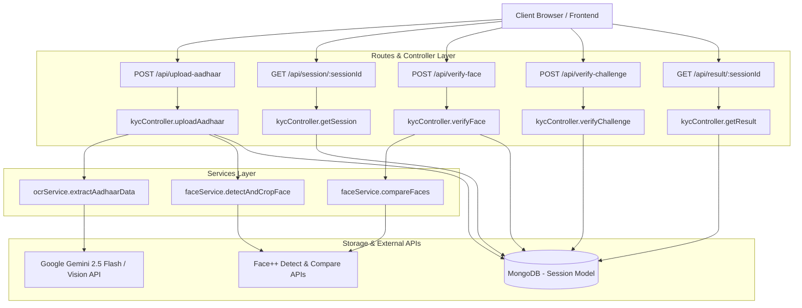

# KYC Backend Documentation & Function Guide

This document provides a comprehensive breakdown of the functions, schemas, routing, and overall wiring of the KYC Verification backend. It explains the mechanics of each file, how data flows, and where each method is integrated.

---

## 🏗️ Architectural Overview & Wiring

The KYC backend is structured as a standard MVC-like Node.js & Express application using MongoDB (via Mongoose) as the persistent store. It integrates with external services for optical character recognition (OCR) and facial recognition:
- **OCR Engine**: Extracts Aadhaar card data (Full Name and Aadhaar Number) using the [Google Gemini 2.5 Flash API](https://ai.google.dev/) (with fallback to the [Google Cloud Vision API](https://cloud.google.com/vision/) or a Mock Mode).
- **Face Recognition Engine**: Automates face detection, cropping, and biometric comparison using the [Face++ APIs](https://www.faceplusplus.com/).
- **Challenge Verification**: Executes client-side physical activity validation (e.g., hand gestures, head turns) using MediaPipe, and processes the outcome on the backend with automated retry loops.

### Data Flow & Wiring Diagram

The diagram below details how the client request enters the API endpoints, triggers controllers, consumes external services, and modifies state in MongoDB.

---

## 🗂️ Detailed File & Function Explanations

---

### 1. Main Entry Point: [server.js](file:///C:/Users/Aryan%20Anand/OneDrive/Desktop/KYC/backend/server.js)

This is the main driver of the application. It configures basic Middlewares (CORS, body parser JSON limits for base64 selfies), initiates the database connection, mounts API routing, handles upload folders initialization, and drives a periodic cleanup cron job.

#### ⚙️ Functions & Background Routines

##### A. [createUploadDirs](file:///C:/Users/Aryan%20Anand/OneDrive/Desktop/KYC/backend/server.js#L38-L49)
* **How it works**: Uses synchronous file system check (`fs.existsSync`) and directory creation (`fs.mkdirSync` with `{ recursive: true }`) to verify and create the folder structure needed for storing uploads. Specifically, it ensures `uploads`, `uploads/aadhaar`, and `uploads/selfies` folders are ready.
* **Import/Export**: Declared locally. Executed immediately upon server start.
* **Wiring**: Automatically called on line 50.

##### B. [setInterval Session Cleanup Job](file:///C:/Users/Aryan%20Anand/OneDrive/Desktop/KYC/backend/server.js#L53-L94)
* **How it works**: Runs every 2 minutes. Queries the MongoDB `Session` collection for records whose status is `PENDING` or `FACE_VERIFIED` and whose creation time (`createdAt`) is older than 10 minutes (defined by `tenMinutesAgo = new Date(Date.now() - 10 * 60 * 1000)`). For each expired session:
  1. Sets its status to `"EXPIRED"`.
  2. Sets `completedAt` to the current time.
  3. Saves the session back to MongoDB.
  4. Deletes associated files on disk (`aadhaarImagePath`, `aadhaarFacePath`, `selfieImagePath`, and audit frame `challenge_[sessionId].jpg`) to maintain user privacy and release storage.
* **Import/Export**: Inline async callback within Node.js native `setInterval`.
* **Wiring**: Standard Node background process running continuously.

---

### 2. Database Connection: [db.js](file:///C:/Users/Aryan%20Anand/OneDrive/Desktop/KYC/backend/config/db.js)

Handles connecting Mongoose to MongoDB.

#### ⚙️ Functions

##### A. [connectDB](file:///C:/Users/Aryan%20Anand/OneDrive/Desktop/KYC/backend/config/db.js#L3-L13)
* **How it works**: Async function that uses `mongoose.connect` to open a database connection using the URI specified in the environment variables (`process.env.MONGODB_URI`). If the variable is absent, it defaults to a local instance at `mongodb://127.0.0.1:27017/kyc-verification`. If connection fails, it writes the error message to the console and halts the application using `process.exit(1)`.
* **Import/Export**: Exported as default module export.
* **Wiring**: Imported on line 6 of [server.js](file:///C:/Users/Aryan%20Anand/OneDrive/Desktop/KYC/backend/server.js#L6) and invoked on line 14.

---

### 3. Session Model Schema: [Session.js](file:///C:/Users/Aryan%20Anand/OneDrive/Desktop/KYC/backend/models/Session.js)

Defines the state structure of a KYC verification session stored in MongoDB.

#### ⚙️ Instance Methods

##### A. [isExpired](file:///C:/Users/Aryan%20Anand/OneDrive/Desktop/KYC/backend/models/Session.js#L57-L62)
* **How it works**: Evaluates whether the current instance has exceeded its active verification window (10 minutes). It immediately returns `true` if the status is already `"EXPIRED"`. Otherwise, it measures the delta between the current timestamp and `createdAt`. If it exceeds 10 minutes (`10 * 60 * 1000` milliseconds), it returns `true`.
* **Import/Export**: Attached to the schema instance via `sessionSchema.methods.isExpired`.
* **Wiring**: Imported implicitly with the `Session` model. Invoked within:
  - [getSession](file:///C:/Users/Aryan%20Anand/OneDrive/Desktop/KYC/backend/controllers/kycController.js#L124) in the controller.
  - [verifyFace](file:///C:/Users/Aryan%20Anand/OneDrive/Desktop/KYC/backend/controllers/kycController.js#L168) in the controller.
  - [verifyChallenge](file:///C:/Users/Aryan%20Anand/OneDrive/Desktop/KYC/backend/controllers/kycController.js#L250) in the controller.

---

### 4. Routing & Middleware Layer: [kycRoutes.js](file:///C:/Users/Aryan%20Anand/OneDrive/Desktop/KYC/backend/routes/kycRoutes.js)

Manages request limits, local file storage parsing using Multer, schema format checks, and mapping endpoints to controller functions.

#### ⚙️ Local Helper Functions & Middlewares

##### A. [fileFilter](file:///C:/Users/Aryan%20Anand/OneDrive/Desktop/KYC/backend/routes/kycRoutes.js#L26-L36)
* **How it works**: Restricts upload file formats for security. Evaluates both the file extension and the mime-type against a regular expression pattern `/jpeg|jpg|png/`. If they match, the upload continues by invoking `cb(null, true)`. Otherwise, it rejects the request with an error.
* **Import/Export**: Passed to the `multer` configuration instance.
* **Wiring**: Configured as part of the `upload` middleware initialization on line 38.

##### B. Rate Limiters: [uploadLimiter](file:///C:/Users/Aryan%20Anand/OneDrive/Desktop/KYC/backend/routes/kycRoutes.js#L45-L49) & [verificationLimiter](file:///C:/Users/Aryan%20Anand/OneDrive/Desktop/KYC/backend/routes/kycRoutes.js#L51-L55)
* **How it works**: Uses `express-rate-limit` to limit API abuse:
  - `uploadLimiter`: Limits a single IP address to a maximum of 15 requests per 15-minute window (specifically for the `/upload-aadhaar` route).
  - `verificationLimiter`: Limits a single IP to 30 requests per 5-minute window (applied on validation steps `/verify-face` and `/verify-challenge`).
* **Wiring**: Placed as route-specific middleware functions in the route declarations.

##### C. Multer Error Handler
* **How it works**: Custom inline Express error-handling middleware (`(err, req, res, next) => { ... }`) that checks if an incoming error is an instance of `multer.MulterError` or a generic validation failure. Sends a client-friendly JSON response with status code `400` instead of letting the application crash or leaking directory stack-traces.
* **Wiring**: Mounted on line 65 of [kycRoutes.js](file:///C:/Users/Aryan%20Anand/OneDrive/Desktop/KYC/backend/routes/kycRoutes.js#L65).

---

### 5. Controller Layer: [kycController.js](file:///C:/Users/Aryan%20Anand/OneDrive/Desktop/KYC/backend/controllers/kycController.js)

This file contains the core business logic. It handles HTTP requests, drives the session lifecycle state machine, coordinates file storage cleanup, and structures response formatting.

#### ⚙️ Helper Functions (Local)

##### A. [maskAadhaar](file:///C:/Users/Aryan%20Anand/OneDrive/Desktop/KYC/backend/controllers/kycController.js#L9-L15)
* **How it works**: Obfuscates sensitive Aadhaar card numbers for client-side display. It strips whitespaces, checks that the result contains at least 4 digits, extracts the last four digits, and prefixes them with masked characters: `XXXX XXXX [last 4 digits]`.
* **Wiring**: Invoked during response serialization in [uploadAadhaar](file:///C:/Users/Aryan%20Anand/OneDrive/Desktop/KYC/backend/controllers/kycController.js#L103), [getSession](file:///C:/Users/Aryan%20Anand/OneDrive/Desktop/KYC/backend/controllers/kycController.js#L140), and [getResult](file:///C:/Users/Aryan%20Anand/OneDrive/Desktop/KYC/backend/controllers/kycController.js#L346).

##### B. [deleteFile](file:///C:/Users/Aryan%20Anand/OneDrive/Desktop/KYC/backend/controllers/kycController.js#L18-L27)
* **How it works**: Synchronously deletes a file at the specified system path using `fs.unlinkSync` if it exists (`fs.existsSync(filePath)`), wrapping the process in a `try/catch` block to handle exceptions.
* **Wiring**: Called within [cleanupSessionMedia](file:///C:/Users/Aryan%20Anand/OneDrive/Desktop/KYC/backend/controllers/kycController.js#L30) and the main controllers if APIs fail during execution.

##### C. [cleanupSessionMedia](file:///C:/Users/Aryan%20Anand/OneDrive/Desktop/KYC/backend/controllers/kycController.js#L30-L39)
* **How it works**: Deletes all assets on disk related to a specific KYC session (the original Aadhaar card image, the cropped Aadhaar face snippet, the user's live verification selfie, and any challenge audit frames).
* **Wiring**: Called inside:
  - `getSession` (line 128) if the session has expired.
  - `verifyFace` (line 220) if face matching fails (below 80%).
  - `verifyChallenge` (line 283) if the session is successfully verified.
  - `verifyChallenge` (line 316) if the user fails both challenge attempts.

#### ⚙️ Controller Endpoints (Exported)

##### A. [uploadAadhaar](file:///C:/Users/Aryan%20Anand/OneDrive/Desktop/KYC/backend/controllers/kycController.js#L42-L111)
* **How it works**: 
  1. Validates that a file has been uploaded in `req.file` (populated by Multer).
  2. Generates a fresh `sessionId` via `crypto.randomUUID()`.
  3. Sends the original image to [extractAadhaarData](file:///C:/Users/Aryan%20Anand/OneDrive/Desktop/KYC/backend/services/ocrService.js#L10) to parse text. If it fails, deletes the uploaded file and responds with a `500` error.
  4. Sends the original image to [detectAndCropFace](file:///C:/Users/Aryan%20Anand/OneDrive/Desktop/KYC/backend/services/faceService.js#L13) to crop the cardholder's face. If face detection fails (meaning no face is present on the card), deletes the uploaded card image and returns a `422 Unprocessable Entity` status.
  5. If both steps succeed, initializes a session record in the database with status `"PENDING"`, saving the paths of the uploaded Aadhaar image and the cropped face.
  6. Responds with `201 Created` status returning the session details (with masked Aadhaar) and the client redirection URL.

##### B. [getSession](file:///C:/Users/Aryan%20Anand/OneDrive/Desktop/KYC/backend/controllers/kycController.js#L114-L151)
* **How it works**: Retrieves the status of a specific session.
  1. Looks up the session via `Session.findOne({ sessionId })`.
  2. Checks expiration via `session.isExpired()`. If expired and not in a finalized state (`EXPIRED`, `VERIFIED`, `FAILED`), updates the database status to `"EXPIRED"`, initiates file unlinking via `cleanupSessionMedia`, and returns a `400` status.
  3. Otherwise, returns the masked session state.

##### C. [verifyFace](file:///C:/Users/Aryan%20Anand/OneDrive/Desktop/KYC/backend/controllers/kycController.js#L154-L233)
* **How it works**: Handles biometric face verification.
  1. Confirms the presence of `sessionId` and `selfie` (base64 image payload) in the body.
  2. Verifies session exists, hasn't expired, and is in the `"PENDING"` state.
  3. Converts the base64 selfie data into a binary buffer, saves it to `uploads/selfies/selfie_[sessionId].jpg`, and updates the session's image path.
  4. Calls [compareFaces](file:///C:/Users/Aryan%20Anand/OneDrive/Desktop/KYC/backend/services/faceService.js#L89) to match the cropped Aadhaar card face with the new selfie.
  5. If the comparison score is **>= 80**: Sets status to `"FACE_VERIFIED"`, randomly picks a liveness challenge from `["SHOW_LEFT_HAND", "SHOW_RIGHT_HAND", "TURN_HEAD_LEFT", "TURN_HEAD_RIGHT"]`, assigns it to the session, and responds with success.
  6. If the score is **< 80**: Rejects the comparison, sets the database status to `"FAILED"`, triggers immediate media deletion via `cleanupSessionMedia`, and returns a failure response.

##### D. [verifyChallenge](file:///C:/Users/Aryan%20Anand/OneDrive/Desktop/KYC/backend/controllers/kycController.js#L236-L331)
* **How it works**: Updates and completes the session liveness test feedback.
  1. Confirms session existence, expiration state, and validates that it has already passed face verification (`FACE_VERIFIED` status).
  2. If the request body includes an `image` (base64 screen capture frame of the challenge execution), saves it to `uploads/selfies/challenge_[sessionId].jpg` for potential system auditing.
  3. Increments the session's `attempts` counter by 1.
  4. If `success` is `true`: Transitions the session to `"VERIFIED"`, sets `completedAt`, triggers `cleanupSessionMedia` to erase images immediately, and returns a verified status.
  5. If `success` is `false`:
     - **First Attempt Failed**: Randomly selects a *different* challenge, saves it as the active challenge, and returns a retry response.
     - **Second Attempt Failed**: Session status is marked `"FAILED"`, files are deleted via `cleanupSessionMedia`, and a failure response is sent.

##### E. [getResult](file:///C:/Users/Aryan%20Anand/OneDrive/Desktop/KYC/backend/controllers/kycController.js#L334-L359)
* **How it works**: Simple, non-destructive endpoint that returns the final KYC state for post-verification pages. It fetches the session by ID and returns its fields (with masked Aadhaar) to the UI without altering data or triggering expiration updates.

---

### 6. OCR Extraction Service: [ocrService.js](file:///C:/Users/Aryan%20Anand/OneDrive/Desktop/KYC/backend/services/ocrService.js)

Connects to cloud APIs to extract text parameters from images.

#### ⚙️ Functions

##### A. [extractAadhaarData](file:///C:/Users/Aryan%20Anand/OneDrive/Desktop/KYC/backend/services/ocrService.js#L10-L238)
* **How it works**: Chooses an OCR execution flow based on environment keys:
  
  ###### Flow 1: Gemini Pro AI (Preferred)
  * Runs if `process.env.GEMINI_API_KEY` is set.
  * Encodes the image file to base64.
  * POSTs a JSON payload containing the image buffer and a prompt to the Google Gemini 2.5 Flash API endpoint.
  * Prompt: *"Analyze the attached Aadhaar card image and extract: 1) The cardholder's Full Name... 2) The 12-digit Aadhaar Number... Return ONLY a JSON object formatted as `{"name": "...", "aadhaarNumber": "..."}`."*
  * Cleans markdown formatting backticks from the result, parses the raw string to JSON, and returns the variables.
  
  ###### Flow 2: Mock Mode (Testing)
  * Runs if `process.env.MOCK_MODE` is `"true"` or keys are set to `"mock"`.
  * Instantly returns a static successful OCR object (Name: `"AARAV SHARMA"`, Number: `"1234 5678 9012"`).
  
  ###### Flow 3: Google Cloud Vision API (Fallback)
  * Runs if `process.env.GOOGLE_VISION_API_KEY` is present.
  * Submits the base64 image payload to the Google Cloud Vision Text Detection API.
  * Parses raw text strings from response annotations.
  * Uses regular expressions to extract the 12-digit Aadhaar number pattern (`\b\d{4}\s\d{4}\s\d{4}\b`, etc.).
  * Uses name-extraction heuristics: Splits text into lines, locates the Date of Birth (`DOB`) line, and scans upward to find uppercase strings containing letters and spaces. It ignores common keywords (e.g., `"GOVERNMENT OF INDIA"`, `"ENROLLMENT"`, `"MALE"`, `"FEMALE"`).
* **Import/Export**: Exported module method.
* **Wiring**: Imported on line 5 of [kycController.js](file:///C:/Users/Aryan%20Anand/OneDrive/Desktop/KYC/backend/controllers/kycController.js#L5).

---

### 7. Face Services: [faceService.js](file:///C:/Users/Aryan%20Anand/OneDrive/Desktop/KYC/backend/services/faceService.js)

Connects to Face++ to handle face detection, cropping, and biometric comparison.

#### ⚙️ Functions

##### A. [detectAndCropFace](file:///C:/Users/Aryan%20Anand/OneDrive/Desktop/KYC/backend/services/faceService.js#L13-L83)
* **How it works**: 
  - **Mock Mode**: Uses the `Jimp` image processing library to crop the center 40% of the uploaded Aadhaar image, saving it directly to `outputFacePath`.
  - **Live Mode**: 
    1. Sends the Aadhaar image to the Face++ Detect API (`/facepp/v3/detect`) using `FormData`.
    2. If no faces are found in the response, it throws an error.
    3. If a face is found, it extracts the bounding box coordinates `{ top, left, width, height }`.
    4. Reads the original image with `Jimp`, adds a 10% padding boundary around the face coordinates, crops the face segment, and writes it to `outputFacePath`.
* **Import/Export**: Exported module method.
* **Wiring**: Imported on line 6 of [kycController.js](file:///C:/Users/Aryan%20Anand/OneDrive/Desktop/KYC/backend/controllers/kycController.js#L6) and called in `uploadAadhaar`.

##### B. [compareFaces](file:///C:/Users/Aryan%20Anand/OneDrive/Desktop/KYC/backend/services/faceService.js#L89-L124)
* **How it works**:
  - **Mock Mode**: Instantly returns a successful match score of `92.5`. However, if the path name of the selfie contains the word `"fail"`, it returns a score of `45.0` to allow testing failure states.
  - **Live Mode**: POSTs both the cropped Aadhaar face snippet and the live selfie image as a multipart form data payload to the Face++ Compare API (`/facepp/v3/compare`). It returns the `confidence` score (0-100) returned by the API.
* **Import/Export**: Exported module method.
* **Wiring**: Imported on line 6 of [kycController.js](file:///C:/Users/Aryan%20Anand/OneDrive/Desktop/KYC/backend/controllers/kycController.js#L6) and called in `verifyFace`.

---

### 8. Testing Utility: [test.js](file:///C:/Users/Aryan%20Anand/OneDrive/Desktop/KYC/backend/test.js)

A standalone script to test the Google Gemini API integration locally.

#### ⚙️ Mechanics
* **How it works**: A script that reads `sample_aadhaar.png` locally, base64 encodes it, and sends it directly to the Google Gemini 2.5 Flash API with a simple text prompt: `"Extract all text from this image."` It uses a hardcoded API key and prints the returned JSON result directly to the console.
* **Wiring**: Standalone development tool. Not imported by other backend files.

---

## 🔌 API Wiring Details (Route to Controller Mapping)

The API routing is wired in [kycRoutes.js](file:///C:/Users/Aryan%20Anand/OneDrive/Desktop/KYC/backend/routes/kycRoutes.js) and mounted under the `/api` prefix in [server.js](file:///C:/Users/Aryan%20Anand/OneDrive/Desktop/KYC/backend/server.js#L30):

| Method | Endpoint | Rate Limiter | Upload Middleware | Controller Function | Description |
| :--- | :--- | :--- | :--- | :--- | :--- |
| **POST** | `/api/upload-aadhaar` | `uploadLimiter` (15 req / 15 min) | Multer: single file (`aadhaar`) | [uploadAadhaar](file:///C:/Users/Aryan%20Anand/OneDrive/Desktop/KYC/backend/controllers/kycController.js#L42) | Uploads Aadhaar card, runs OCR and face cropping, creates a DB session, and returns the session state. |
| **GET** | `/api/session/:sessionId` | *None* | *None* | [getSession](file:///C:/Users/Aryan%20Anand/OneDrive/Desktop/KYC/backend/controllers/kycController.js#L114) | Checks session status and expiration, returning masked session parameters to the client. |
| **POST** | `/api/verify-face` | `verificationLimiter` (30 req / 5 min) | *None* | [verifyFace](file:///C:/Users/Aryan%20Anand/OneDrive/Desktop/KYC/backend/controllers/kycController.js#L154) | Decodes the base64 selfie, compares it with the Aadhaar face, and generates a random liveness challenge if successful. |
| **POST** | `/api/verify-challenge` | `verificationLimiter` (30 req / 5 min) | *None* | [verifyChallenge](file:///C:/Users/Aryan%20Anand/OneDrive/Desktop/KYC/backend/controllers/kycController.js#L236) | Validates liveness challenge status. Completes verification on success, or triggers retry loops on failure. |
| **GET** | `/api/result/:sessionId` | *None* | *None* | [getResult](file:///C:/Users/Aryan%20Anand/OneDrive/Desktop/KYC/backend/controllers/kycController.js#L334) | Fetches the final verification results (Aadhaar details, match scores, attempts, and completion timestamp). |
