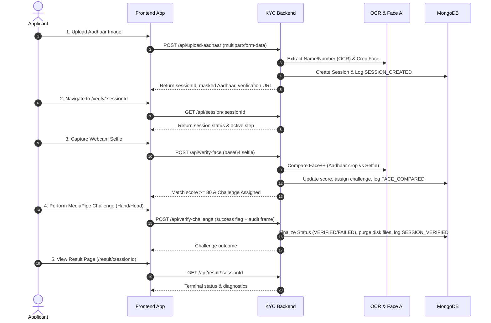
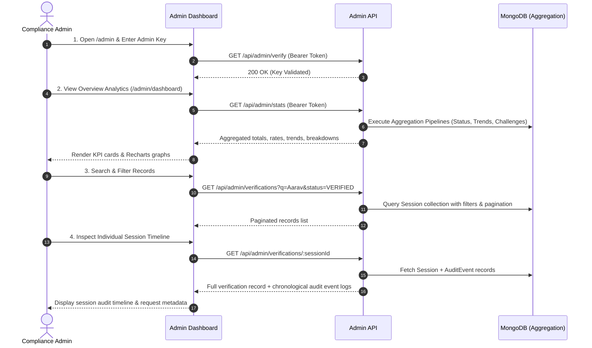

# Product Requirements Document (PRD)

# Automated Video KYC Verification System with Admin Intelligence & Audit Trail

## 1. Purpose

The purpose of this product is to provide a complete, end-to-end automated Video KYC verification system comprising two core operational sides:
1. **Applicant Verification Pipeline**: An automated, browser-based flow where applicants upload an Aadhaar card, undergo identity extraction (OCR) and facial cropping, verify identity via live webcam selfie comparison, and complete dynamic physical liveness challenges (MediaPipe).
2. **Admin Intelligence & Audit Dashboard**: A secured administrative portal where compliance operators can monitor system health, inspect aggregation-driven verification analytics (pass rates, face match averages, volume trends, challenge breakdowns), search and filter historical records, and inspect append-only audit timelines for each verification session.

The product is built as a production-grade prototype demonstrating modern identity verification architectures, privacy-first PII handling (salted hashing and masked values), and granular lifecycle auditing.

## 2. Problem Statement

Manual KYC verification is slow, expensive, and vulnerable to human error. Conversely, naive automated uploads are vulnerable to presentation attacks (using someone else's static document photo or digital screen replay). Furthermore, compliance and security standards require:
- **Identity Integrity**: Confirming that the physical person in front of the camera matches the individual on the uploaded government document.
- **Liveness Proof**: Proving physical presence in real-time through unpredictable physical gestures.
- **Privacy & PII Protection**: Preventing storage of raw plaintext identity numbers (such as Aadhaar) in application databases.
- **Operational Auditing**: Giving compliance teams complete visibility into failure rates, challenge drop-offs, lifecycle events, and individual session histories.

This product solves these challenges by combining computer vision pipelines with an auditable, aggregation-backed database and administrative dashboard.

## 3. Product Goals

- **Automated Document Processing**: Extract applicant name and Aadhaar number from uploaded card images via OCR.
- **Privacy-Preserving Storage**: Store zero plaintext Aadhaar numbers. Persist only display-masked strings (`XXXX XXXX 1234`) and salted SHA-256 digests (`sha256(PEPPER:digits)`) for distinct-applicant metrics.
- **Biometric Matching**: Compare cropped Aadhaar photos with live webcam selfies using facial recognition embeddings.
- **Browser-Side Liveness Detection**: Validate physical challenges (hand gestures and head rotations) in real-time using client-side MediaPipe ML models.
- **Ephemeral Media Retention**: Automatically purge biometric images (Aadhaar cards, cropped faces, selfies) upon terminal session states (`VERIFIED`, `FAILED`, `EXPIRED`) to protect user privacy.
- **Append-Only Audit Trail**: Log every milestone event (`SESSION_CREATED`, `FACE_COMPARED`, `CHALLENGE_ATTEMPTED`, `SESSION_VERIFIED`, `SESSION_FAILED`, `SESSION_EXPIRED`) to a dedicated `AuditEvent` collection.
- **Admin Intelligence Dashboard**: Surface real-time metrics, status breakdowns, 30-day volume trends, and challenge performance via MongoDB aggregation pipelines and interactive Recharts data visualizations.
- **Verifications Explorer**: Allow operators to search, filter by status, sort, and paginate through all verification records.
- **Mock Mode**: Enable full-suite offline demonstrations and testing without active third-party cloud credentials.

## 4. Target Users

### Primary User: Applicant
An applicant completing an online onboarding or identity verification process from their desktop or mobile browser.

### Secondary User: Compliance Officer / KYC Admin
An authorized administrative operator who monitors system verification throughput, audits suspicious or failed sessions, analyzes liveness drop-offs, and inspects event timelines.

### Tertiary User: System Evaluator / Interviewer
A technical reviewer examining the architectural design, security boundaries, and full-stack implementation of the KYC workflow.

## 5. Scope

### In Scope

#### Applicant Flow
- Aadhaar card image upload (JPG, JPEG, PNG validation, 5MB ceiling).
- OCR text extraction (Google Gemini 2.5 Flash / Google Cloud Vision / Mock mode).
- Aadhaar number display masking (`XXXX XXXX 1234`).
- Automatic face detection and padded cropping from document image (Face++ / Jimp Mock).
- Time-bounded session generation (10-minute validity, unique UUID).
- Live webcam selfie capture.
- Biometric facial comparison with configurable confidence threshold (>= 80% pass).
- Dynamic, randomized liveness challenges: Left Hand, Right Hand, Turn Head Left, Turn Head Right.
- Real-time client-side MediaPipe landmark detection with interactive visual cues and countdown timer.
- Challenge retry logic (1 retry allowed on initial challenge failure).
- Terminal result page with comprehensive diagnostics and status explanations.
- Automatic disk cleanup of temporary biometric media on completion or expiry.

#### Database & Admin Intelligence
- Persistent MongoDB storage with indexing on session identifiers, status, and creation dates.
- PII protection via salted SHA-256 Aadhaar hashing with server-side pepper.
- Request metadata logging (IP address, user agent).
- Separate, append-only `AuditEvent` collection recording full verification lifecycles.
- Secure Admin Authentication using shared secret bearer tokens with constant-time verification.
- Admin rate limiting to prevent brute-force attacks and dashboard polling abuse.
- Interactive Admin Analytics Dashboard powered by MongoDB aggregation pipelines and Recharts.
- Verifications Explorer featuring regex search, status filtering, date range constraints, sorting, and pagination.
- Per-verification Detail View rendering metadata, pass scores, request origins, and sequential audit event timelines.

### Out of Scope
- Direct integration with UIDAI / Government Aadhaar backend databases.
- Hardware-based biometric fingerprint/iris scanners.
- Multi-tenant enterprise RBAC with granular permission trees and individual employee accounts.
- Payment, subscription, or billing workflows.
- Live video-streaming call sessions with human KYC agents (e.g., WebRTC video conference).
- Automated cloud infrastructure provisioning scripts (Terraform/Kubernetes).

## 6. User Journeys

### Journey A: Applicant Verification Flow

### Journey B: Admin & Compliance Flow

## 7. Functional Requirements

### FR1: Aadhaar Document Upload
The system must allow applicants to upload an Aadhaar image with client and server-side validation.
- File types: JPG, JPEG, PNG.
- Max file size: 5MB.
- Rate limiting: 15 uploads per 15 minutes per IP.

### FR2: OCR Data Extraction & Privacy Masking
The system must parse identity attributes and safeguard them immediately.
- Extracts applicant name and 12-digit Aadhaar number.
- Masks the Aadhaar number into display format (`XXXX XXXX 1234`).
- Computes salted SHA-256 hash using server-side pepper for database indexing.
- Never writes unmasked Aadhaar numbers to persistent storage or API responses.

### FR3: Document Face Detection & Cropping
The system must isolate the portrait photograph from the document.
- Detects bounding box of the cardholder's face.
- Crops the portrait with 10% safety margin padding.
- Rejects documents without clear, detectable faces with error code 422.

### FR4: Session Lifecycle Management
The system must maintain stateful verification sessions.
- Session IDs generated using cryptographically random UUIDs (`crypto.randomUUID()`).
- Session statuses: `PENDING` -> `FACE_VERIFIED` -> `VERIFIED` / `FAILED` / `EXPIRED`.
- Sessions automatically expire 10 minutes after creation.

### FR5: Biometric Face Comparison
The system must match the live webcam selfie against the cropped Aadhaar face.
- Accepts base64 encoded image from webcam.
- Evaluates biometric similarity (0-100 confidence).
- Match threshold >= 80 transitions session to `FACE_VERIFIED`.
- Match score < 80 immediately fails the session.

### FR6: Dynamic Browser Liveness Challenge
The system must challenge the applicant with an unpredictable physical action.
- Random selection from `SHOW_LEFT_HAND`, `SHOW_RIGHT_HAND`, `TURN_HEAD_LEFT`, `TURN_HEAD_RIGHT`.
- Real-time client-side ML tracking using MediaPipe Hands and Face Mesh.
- 10-second completion countdown with live feedback cues.
- Provides 1 retry attempt with a different challenge on initial failure.
- Two consecutive failures transitions session to `FAILED`.

### FR7: Biometric File Cleanup & Purging
The system must minimize data liability by deleting temporary media.
- Deletes uploaded Aadhaar document, cropped face, selfie, and challenge frame upon reaching terminal status (`VERIFIED`, `FAILED`, `EXPIRED`).
- Periodic cleanup job scans for abandoned sessions older than 10 minutes every 2 minutes.

### FR8: Admin Authentication & Access Guard
The administrative portal must require authenticated access.
- Validates bearer token against server-side `ADMIN_TOKEN` using timing-safe buffer comparison.
- Rate-limits admin routes to 200 requests per 5-minute window.
- Client-side React route guards prevent unauthorized access to `/admin/dashboard` and `/admin/verifications/:id`.

### FR9: Verifications Explorer & Filtering
The admin interface must allow comprehensive browsing of all sessions.
- Supports case-insensitive regex search by applicant name or masked Aadhaar number.
- Filters by session status (`PENDING`, `FACE_VERIFIED`, `VERIFIED`, `FAILED`, `EXPIRED`).
- Filters by creation date range (`from` and `to`).
- Supports sorting by newest, oldest, and face match score.
- Implements server-side pagination with configurable page limits.

### FR10: Audit Event Logging
The backend must maintain a persistent, append-only history of every lifecycle event.
- Events logged: `SESSION_CREATED`, `FACE_COMPARED`, `CHALLENGE_ATTEMPTED`, `SESSION_VERIFIED`, `SESSION_FAILED`, `SESSION_EXPIRED`.
- Captures event timestamp, message, type, and contextual metadata (scores, challenge type, failure reason).
- Does not block primary user requests (asynchronous fire-and-forget logging).

### FR11: Aggregation Analytics & Visualization
The dashboard must aggregate high-level metrics without pulling raw dataset documents.
- Overall metrics: total sessions, distinct applicants, pass rate, average face match score, challenge success rate.
- Status distribution breakdown across all 5 valid lifecycle statuses.
- 30-day temporal verification volume trends (total, verified, failed).
- Challenge outcome analysis grouped by challenge variant.
- Visualized using responsive Recharts graphs (BarChart, AreaChart, PieChart).

## 8. Non-Functional Requirements

### Security & Privacy
- **Zero Plaintext PII**: Plaintext Aadhaar numbers are never persisted in MongoDB. Only salted SHA-256 digests and display-masked values are stored.
- **Timing-Safe Auth**: Admin token validation utilizes `crypto.timingSafeEqual` to eliminate timing side-channel vulnerabilities.
- **Network Protection**: Express rate limiting protects both public upload/verification routes and admin APIs.
- **Ephemeral Storage**: Biometric assets are unlinked from disk immediately upon session termination.

### Performance
- **Browser-Side ML**: MediaPipe models run directly in the client browser, offloading heavy landmark detection from the backend server.
- **MongoDB Aggregation**: Dashboard analytics are computed in-database via multi-stage aggregation pipelines rather than memory-heavy in-code processing.
- **Indexing**: Database fields `sessionId`, `status`, `createdAt`, and `aadhaarHash` are indexed for fast sub-millisecond querying.

### Reliability & Resilience
- **Mock Mode**: Complete system functionality (OCR, face detection, comparison, and liveness) functions seamlessly without third-party API credentials when `MOCK_MODE=true`.
- **Fail-Safe Cleanup**: Background interval cleanup ensures abandoned sessions are expired and their media purged even if client connections drop.

## 9. Success Metrics

| Metric | Target | Measurement Method |
| :--- | :--- | :--- |
| **Pipeline Completion Time** | < 90 seconds | From Aadhaar upload to final verification result |
| **Face Match Accuracy** | >= 95% on clean images | Face++ biometric confidence threshold >= 80 |
| **Liveness Responsiveness** | Real-time (> 20 FPS) | Client-side MediaPipe landmark inference |
| **Data Privacy Compliance** | 0 plaintext Aadhaar leaks | Database inspection confirming only masked & salted hashes |
| **Admin Dashboard Latency** | < 250ms query response | MongoDB aggregation pipeline benchmarks |
| **Media Retention Window** | 0 persistent biometric files | Verification of empty upload directories post-terminal states |

## 10. Risks and Mitigations

| Risk | Impact | Mitigation |
| :--- | :--- | :--- |
| **External AI API Outages** | Verification blocked | Mock Mode fallback enables full functionality during third-party downtime |
| **Aadhaar Data Exposure** | Privacy violation | Salting with private pepper + SHA-256 hash; store and return only masked strings |
| **Admin Brute Force** | Unauthorized dashboard access | Pre-auth rate limiting (200 req / 5 min) and timing-safe token comparison |
| **Client Abandons Session** | Orphaned biometric media on disk | Background cleanup worker runs every 2 minutes, expiring stale sessions and unlinking files |
| **Camera Permission Denial** | Verification cannot proceed | Frontend displays clear permission prompts and diagnostic guidance |
