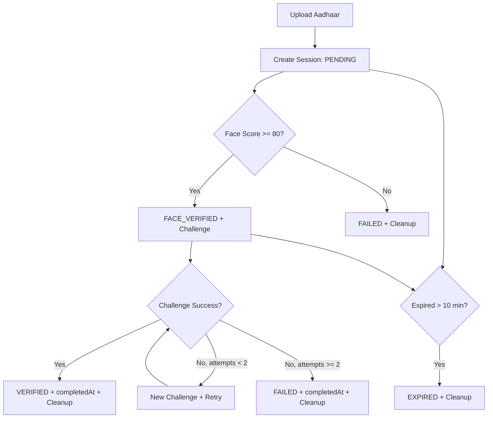

# Database Workflow Documentation (KYC Project)

## 1. Overview

This project uses **MongoDB** with **Mongoose** to store and manage KYC verification sessions.

The database stores the complete verification lifecycle for one user session:
- Aadhaar upload details
- OCR-extracted identity fields
- face match metadata
- challenge status and attempts
- final verification outcome
- timestamps for expiry and completion

Main collection:
- `sessions`

Main model:
- `backend/models/Session.js`

Connection setup:
- `backend/config/db.js`

---

## 2. Database Connection Flow

### File: `backend/config/db.js`

1. App startup calls `connectDB()` from `server.js`.
2. Mongoose connects using:
   - `process.env.MONGODB_URI` if provided
   - fallback: `mongodb://127.0.0.1:27017/kyc-verification`
3. On success, Mongo host is logged.
4. On failure, error is logged and process exits.

### Startup order in `server.js`

1. Load env vars
2. Create Express app
3. Call `connectDB()`
4. Register middleware and routes
5. Start expiry cleanup interval job
6. Start HTTP server

---

## 3. Session Data Model (Schema)

### File: `backend/models/Session.js`

Each document in `sessions` tracks one verification journey.

### Fields

- `sessionId` (String, required, unique)
  - Public-safe session identifier returned to frontend
  - Generated via `crypto.randomUUID()`

- `name` (String, default `""`)
  - Extracted from Aadhaar OCR

- `aadhaarNumber` (String, default `""`)
  - Raw extracted value (response masking is handled in controller)

- `aadhaarImagePath` (String, default `""`)
  - Stored file path for uploaded Aadhaar image

- `aadhaarFacePath` (String, default `""`)
  - Stored file path for cropped Aadhaar face image

- `selfieImagePath` (String, default `""`)
  - Stored file path for selfie used in face compare

- `faceMatchScore` (Number, default `0`)
  - Rounded confidence score from face API

- `challenge` (String enum)
  - Values: `SHOW_LEFT_HAND`, `SHOW_RIGHT_HAND`, `TURN_HEAD_LEFT`, `TURN_HEAD_RIGHT`, `""`

- `attempts` (Number, default `0`)
  - Number of challenge verification attempts performed

- `status` (String enum)
  - Values: `PENDING`, `FACE_VERIFIED`, `VERIFIED`, `FAILED`, `EXPIRED`

- `createdAt` (Date, default `Date.now`)
  - Session creation timestamp

- `completedAt` (Date, optional)
  - Set when session ends (`VERIFIED`, `FAILED`, or cron-expired flow)

### Model Method

- `isExpired()`
  - Returns true when:
    - status already `EXPIRED`, or
    - current time - `createdAt` > 10 minutes

---

## 4. State Machine (Status Lifecycle)

The session status follows this progression:

1. `PENDING`
   - session created after Aadhaar upload + OCR + Aadhaar face crop

2. `FACE_VERIFIED`
   - selfie matched with Aadhaar face (confidence >= 80)
   - random liveness challenge assigned

3. Final states:
   - `VERIFIED` (challenge success)
   - `FAILED` (face mismatch or challenge attempts exhausted)
   - `EXPIRED` (time limit exceeded)

### Transition rules

- `PENDING -> FACE_VERIFIED`
  - if face compare confidence >= 80

- `PENDING -> FAILED`
  - if face compare confidence < 80

- `FACE_VERIFIED -> VERIFIED`
  - if challenge success true

- `FACE_VERIFIED -> FAILED`
  - if challenge fails on second attempt

- `PENDING/FACE_VERIFIED -> EXPIRED`
  - if older than 10 minutes
  - can happen in API request path (`isExpired()`) or periodic cron job

---

## 5. End-to-End DB Workflow by API

### A) `POST /api/upload-aadhaar`
Controller: `uploadAadhaar`

DB workflow:
1. Receive uploaded Aadhaar file (multer)
2. OCR extracts name and Aadhaar number
3. Face service crops Aadhaar face
4. Create new `Session` document with:
   - `sessionId`
   - OCR fields
   - image paths
   - `status = PENDING`
   - `createdAt = now`
5. Save document with `session.save()`
6. Return masked Aadhaar + verification link

Failure behavior:
- If OCR/face steps fail, uploaded file cleanup happens and session is not persisted.

---

### B) `GET /api/session/:sessionId`
Controller: `getSession`

DB workflow:
1. Find by `sessionId`
2. If not found -> 404
3. Check expiry using `session.isExpired()`
4. If expired and not final, update:
   - `status = EXPIRED`
   - save session
   - cleanup media files
5. Return current status snapshot

---

### C) `POST /api/verify-face`
Controller: `verifyFace`

DB workflow:
1. Find session by `sessionId`
2. Validate status must be `PENDING`
3. Check expiry and expire if needed
4. Save selfie image path to session
5. Compare Aadhaar face vs selfie
6. Update `faceMatchScore`
7. Branch:
   - score >= 80:
     - set random `challenge`
     - set `status = FACE_VERIFIED`
     - save
   - score < 80:
     - set `status = FAILED`
     - save
     - cleanup media

---

### D) `POST /api/verify-challenge`
Controller: `verifyChallenge`

DB workflow:
1. Find session by `sessionId`
2. Validate status must be `FACE_VERIFIED`
3. Check expiry and expire if needed
4. Optional challenge frame image saved
5. Increment `attempts`
6. Branch:
   - `success = true`:
     - `status = VERIFIED`
     - `completedAt = now`
     - save
     - cleanup media
   - `success = false` and `attempts < 2`:
     - assign a new challenge
     - keep `status = FACE_VERIFIED`
     - save
   - `success = false` and `attempts >= 2`:
     - `status = FAILED`
     - `completedAt = now`
     - save
     - cleanup media

---

### E) `GET /api/result/:sessionId`
Controller: `getResult`

DB workflow:
1. Find by `sessionId`
2. Return final/current status summary fields
3. Aadhaar number is masked in API response

---

## 6. Expiry and Cleanup Workflow

The project has **two expiry enforcement layers**:

### 1. Request-time expiry check
Inside controllers (`getSession`, `verifyFace`, `verifyChallenge`):
- `isExpired()` called on each request
- old sessions are marked `EXPIRED`
- media files are deleted

### 2. Background expiry job
In `server.js` every 2 minutes:
- Query sessions where:
  - `status` in `PENDING`, `FACE_VERIFIED`
  - `createdAt` older than 10 minutes
- For each match:
  - set `status = EXPIRED`
  - set `completedAt`
  - save
  - delete local media files

This protects against stale sessions even if no further API requests are made.

---

## 7. Data Privacy and Storage Notes

### Current behavior
- Aadhaar number stored in DB as extracted text
- Aadhaar number returned masked (e.g. `XXXX XXXX 1234`)
- image files stored on local disk under:
  - `backend/uploads/aadhaar`
  - `backend/uploads/selfies`
- files are deleted on terminal states or expiry paths

### Important improvement suggestions
- Encrypt Aadhaar number at rest
- Add MongoDB TTL strategy if archival policy allows hard deletion
- Add audit logs for status transitions
- Move media to object storage (S3/GCS/Azure Blob) for scale
- Use hashed or tokenized PII identifiers in logs

---

## 8. Indexing and Performance Considerations

### Already present
- Unique index on `sessionId` via schema `unique: true`

### Recommended indexes
- `status` index for expiry scans
- compound index `{ status: 1, createdAt: 1 }` for cron query efficiency
- optional index on `createdAt` for analytics/reporting

Example (future migration idea):

```js
sessionSchema.index({ status: 1, createdAt: 1 });
```

---

## 9. Error Handling Strategy Around DB

- Not-found sessions always return 404
- Invalid state transitions return 400
- OCR/face external failures mapped to proper responses
- DB save/find failures return 500 with safe message
- media cleanup attempts are wrapped and logged

This keeps DB state consistent with verification lifecycle as much as possible.

---

## 10. Workflow Diagram (For Explanation)



---

## 11. Quick Collection Example (Session Document Snapshot)

```json
{
  "_id": "...",
  "sessionId": "9d7c...",
  "name": "Ravi Kumar",
  "aadhaarNumber": "123456789012",
  "aadhaarImagePath": "backend/uploads/aadhaar/aadhaar-...jpg",
  "aadhaarFacePath": "backend/uploads/aadhaar/face_9d7c....jpg",
  "selfieImagePath": "backend/uploads/selfies/selfie_9d7c....jpg",
  "faceMatchScore": 86,
  "challenge": "TURN_HEAD_LEFT",
  "attempts": 1,
  "status": "FACE_VERIFIED",
  "createdAt": "2026-07-13T10:00:00.000Z",
  "completedAt": null
}
```

---

## 12. How to Explain This in a Demo

Use this 5-step script:

1. Session creation:
   - Aadhaar upload triggers OCR + face crop, then DB document is created in `PENDING`.
2. Identity match:
   - selfie is compared with Aadhaar face, DB stores `faceMatchScore`.
3. Liveness challenge:
   - if score is high, status moves to `FACE_VERIFIED` and challenge is assigned.
4. Final decision:
   - challenge success -> `VERIFIED`, else retry/fail logic updates DB.
5. Auto expiry:
   - after 10 minutes, stale sessions become `EXPIRED` and media is cleaned.

This gives a complete, traceable and auditable session lifecycle in MongoDB.
