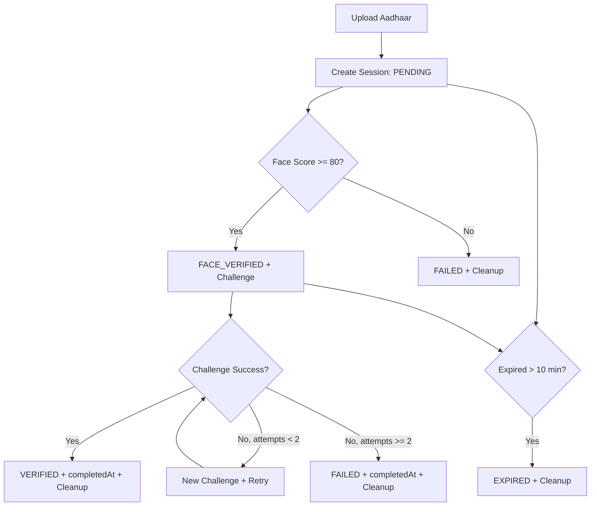

# Database Workflow Documentation (KYC Project)

## 1. Overview

This project uses **MongoDB** with **Mongoose** to store and manage KYC verification sessions.

The database is a **first-class part of the product**, not just transient session scratch space. Every verification becomes a permanent, secured, queryable record with a full audit trail of its lifecycle, and the data is surfaced through an admin dashboard whose analytics are driven by MongoDB aggregation.

The database stores:
- Aadhaar upload details (image paths, cleared on terminal states)
- OCR-extracted identity fields (name)
- **secured** Aadhaar identity: a salted SHA-256 hash + a masked value (never recoverable plaintext)
- request metadata (IP address, user agent) captured at upload
- face match metadata
- challenge status and attempts
- final verification outcome
- creation / update / completion timestamps
- a separate, append-only **audit trail** of every lifecycle event

Main collections:
- `sessions` — one persistent document per verification
- `auditevents` — append-only lifecycle events, linked to a session by `sessionId`

Main models:
- `backend/models/Session.js`
- `backend/models/AuditEvent.js`

Supporting modules:
- `backend/services/auditService.js` — fire-and-forget `logEvent()` helper
- `backend/controllers/adminController.js` + `backend/routes/adminRoutes.js` — admin list / detail / analytics
- `backend/middleware/adminAuth.js` — shared-key `Authorization: Bearer` guard

Connection setup:
- `backend/config/db.js`

---

## 2. Database Connection Flow

### File: `backend/config/db.js`

1. App startup calls `connectDB()` from `server.js`.
2. Mongoose connects using:
   - `process.env.MONGODB_URI` if provided
   - fallback: `mongodb://127.0.0.1:27017/kyc-verification`
3. On success, Mongo host is logged.
4. On failure, error is logged and process exits.

### Startup order in `server.js`

1. Load env vars
2. Create Express app
3. Call `connectDB()`
4. Register middleware and routes
5. Start expiry cleanup interval job
6. Start HTTP server

---

## 3. Session Data Model (Schema)

### File: `backend/models/Session.js`

Each document in `sessions` tracks one verification journey.

### Fields

- `sessionId` (String, required, unique)
  - Public-safe session identifier returned to frontend
  - Generated via `crypto.randomUUID()`

- `name` (String, default `""`)
  - Extracted from Aadhaar OCR

- `aadhaarHash` (String, default `""`, indexed)
  - Salted SHA-256 digest of the digits-only Aadhaar number: `sha256(PEPPER + ":" + digits)`
  - Not reversible; enables distinct-applicant analytics without storing PII
  - The pepper comes from `process.env.AADHAAR_HASH_PEPPER`

- `aadhaarMasked` (String, default `""`)
  - Display-safe value, e.g. `XXXX XXXX 9012`; this is what API responses return
  - No plaintext Aadhaar number is ever persisted

- `aadhaarImagePath` (String, default `""`)
  - Stored file path for uploaded Aadhaar image

- `aadhaarFacePath` (String, default `""`)
  - Stored file path for cropped Aadhaar face image

- `selfieImagePath` (String, default `""`)
  - Stored file path for selfie used in face compare

- `faceMatchScore` (Number, default `0`)
  - Rounded confidence score from face API

- `challenge` (String enum)
  - Values: `SHOW_LEFT_HAND`, `SHOW_RIGHT_HAND`, `TURN_HEAD_LEFT`, `TURN_HEAD_RIGHT`, `""`

- `attempts` (Number, default `0`)
  - Number of challenge verification attempts performed

- `status` (String enum)
  - Values: `PENDING`, `FACE_VERIFIED`, `VERIFIED`, `FAILED`, `EXPIRED`

- `ipAddress` (String, default `""`)
  - Requester IP captured at Aadhaar upload (`req.ip`), for audit/analytics

- `userAgent` (String, default `""`)
  - Requester user-agent captured at Aadhaar upload

- `createdAt` / `updatedAt` (Date)
  - Supplied automatically by Mongoose `{ timestamps: true }`
  - `isExpired()` still reads `this.createdAt` for the 10-minute window

- `completedAt` (Date, optional)
  - Set when session ends (`VERIFIED`, `FAILED`, or any `EXPIRED` path)

### Model Method

- `isExpired()`
  - Returns true when:
    - status already `EXPIRED`, or
    - current time - `createdAt` > 10 minutes

---

## 3A. Audit Trail Model (AuditEvent)

### File: `backend/models/AuditEvent.js`

A separate `auditevents` collection records every meaningful lifecycle event. It is kept **separate from the session document** (not an embedded array) so the session stays lean, events can grow unbounded, and cross-session analytics via aggregation are cheap.

### Fields

- `sessionId` (String, required, indexed) — links to `Session.sessionId`
- `type` (String enum, required) — the event kind (see list below)
- `message` (String) — short human-readable description
- `meta` (Mixed, default `{}`) — structured payload (e.g. `{ score, threshold }`, `{ challenge, attempt, success }`)
- `createdAt` / `updatedAt` — via `{ timestamps: true }`

### Event types

`SESSION_CREATED`, `OCR_EXTRACTED`, `FACE_CROPPED`, `FACE_COMPARED`, `FACE_PASSED`, `FACE_FAILED`, `CHALLENGE_ASSIGNED`, `CHALLENGE_ATTEMPTED`, `CHALLENGE_PASSED`, `CHALLENGE_FAILED`, `SESSION_VERIFIED`, `SESSION_FAILED`, `SESSION_EXPIRED`, `MEDIA_CLEANED`.

### Indexes

- `{ sessionId: 1, createdAt: 1 }` — fetch a session's timeline in order
- `{ type: 1 }` — analytics grouped by event kind
- `{ createdAt: 1 }` — time-range scans

### Logging helper

`backend/services/auditService.js` exposes `logEvent(sessionId, type, message = '', meta = {})`. It wraps `AuditEvent.create(...)` in try/catch and never throws, so an audit-logging failure can never break the verification flow (fire-and-forget).

---

## 4. State Machine (Status Lifecycle)

The session status follows this progression:

1. `PENDING`
   - session created after Aadhaar upload + OCR + Aadhaar face crop

2. `FACE_VERIFIED`
   - selfie matched with Aadhaar face (confidence >= 80)
   - random liveness challenge assigned

3. Final states:
   - `VERIFIED` (challenge success)
   - `FAILED` (face mismatch or challenge attempts exhausted)
   - `EXPIRED` (time limit exceeded)

### Transition rules

- `PENDING -> FACE_VERIFIED`
  - if face compare confidence >= 80

- `PENDING -> FAILED`
  - if face compare confidence < 80

- `FACE_VERIFIED -> VERIFIED`
  - if challenge success true

- `FACE_VERIFIED -> FAILED`
  - if challenge fails on second attempt

- `PENDING/FACE_VERIFIED -> EXPIRED`
  - if older than 10 minutes
  - can happen in API request path (`isExpired()`) or periodic cron job

---

## 5. End-to-End DB Workflow by API

### A) `POST /api/upload-aadhaar`
Controller: `uploadAadhaar`

DB workflow:
1. Receive uploaded Aadhaar file (multer)
2. OCR extracts name and Aadhaar number
3. Face service crops Aadhaar face
4. Create new `Session` document with:
   - `sessionId`
   - OCR fields
   - image paths
   - `status = PENDING`
   - `createdAt = now`
5. Save document with `session.save()`
6. Return masked Aadhaar + verification link

Failure behavior:
- If OCR/face steps fail, uploaded file cleanup happens and session is not persisted.

---

### B) `GET /api/session/:sessionId`
Controller: `getSession`

DB workflow:
1. Find by `sessionId`
2. If not found -> 404
3. Check expiry using `session.isExpired()`
4. If expired and not final, update:
   - `status = EXPIRED`
   - save session
   - cleanup media files
5. Return current status snapshot

---

### C) `POST /api/verify-face`
Controller: `verifyFace`

DB workflow:
1. Find session by `sessionId`
2. Validate status must be `PENDING`
3. Check expiry and expire if needed
4. Save selfie image path to session
5. Compare Aadhaar face vs selfie
6. Update `faceMatchScore`
7. Branch:
   - score >= 80:
     - set random `challenge`
     - set `status = FACE_VERIFIED`
     - save
   - score < 80:
     - set `status = FAILED`
     - save
     - cleanup media

---

### D) `POST /api/verify-challenge`
Controller: `verifyChallenge`

DB workflow:
1. Find session by `sessionId`
2. Validate status must be `FACE_VERIFIED`
3. Check expiry and expire if needed
4. Optional challenge frame image saved
5. Increment `attempts`
6. Branch:
   - `success = true`:
     - `status = VERIFIED`
     - `completedAt = now`
     - save
     - cleanup media
   - `success = false` and `attempts < 2`:
     - assign a new challenge
     - keep `status = FACE_VERIFIED`
     - save
   - `success = false` and `attempts >= 2`:
     - `status = FAILED`
     - `completedAt = now`
     - save
     - cleanup media

---

### E) `GET /api/result/:sessionId`
Controller: `getResult`

DB workflow:
1. Find by `sessionId`
2. Return final/current status summary fields
3. Aadhaar number is masked in API response

---

> **Audit logging:** every step above also records `AuditEvent` rows via `logEvent(...)`.
> `uploadAadhaar` logs `SESSION_CREATED`, `OCR_EXTRACTED`, `FACE_CROPPED`; `verifyFace` logs
> `FACE_COMPARED` then `FACE_PASSED`+`CHALLENGE_ASSIGNED` or `FACE_FAILED`+`SESSION_FAILED`;
> `verifyChallenge` logs `CHALLENGE_ATTEMPTED` then `CHALLENGE_PASSED`+`SESSION_VERIFIED`,
> `CHALLENGE_FAILED`+`CHALLENGE_ASSIGNED` (retry), or `CHALLENGE_FAILED`+`SESSION_FAILED`;
> expiry paths log `SESSION_EXPIRED`; media cleanup logs `MEDIA_CLEANED`.

---

## 5A. Admin & Analytics API

Controller: `backend/controllers/adminController.js` · Routes: `backend/routes/adminRoutes.js`

All admin routes are mounted at `/api/admin` (**before** the public `/api` routes) and sit behind:
1. `adminLimiter` — an `express-rate-limit` instance (200 requests / 5 min).
2. `requireAdmin` — reads `Authorization: Bearer <token>`, constant-time compares it
   (`crypto.timingSafeEqual`) against `process.env.ADMIN_TOKEN`; returns `401` on
   missing/mismatch and fails closed with `500` if `ADMIN_TOKEN` is unset.

### A) `GET /api/admin/verify`
- Lightweight token check used by the login screen. Returns `{ ok: true }` when the key is valid.

### B) `GET /api/admin/verifications`
- Paginated, filterable list. Query params: `page`, `limit` (max 100), `status`, `q`
  (regex on name / masked Aadhaar), `from`, `to` (createdAt range), `sort`
  (`newest` | `oldest` | `score`).
- Returns `{ items, total, page, pages, limit }`. Only masked, non-PII fields are selected;
  disk paths and the hash are never returned in the list.

### C) `GET /api/admin/verifications/:sessionId`
- Returns `{ verification, events }` — the record (masked fields + `aadhaarHash`, `ipAddress`,
  `userAgent`, `updatedAt`) plus its full `AuditEvent` timeline sorted ascending
  (`{ createdAt: 1, _id: 1 }`).

### D) `GET /api/admin/stats`
- Dashboard analytics computed **entirely with MongoDB aggregation** (`Promise.all` of pipelines):
  - `totals` — counts by status (`$group` on `$status`), `today`, and distinct applicants
    (`$group` on `aadhaarHash` → `$count`).
  - `rates` — `passRate`, `avgFaceMatchScore` (`$avg` over sessions with score > 0),
    `challengeSuccessRate`.
  - `statusBreakdown` — count per status (all five).
  - `verificationsOverTime` — last 30 days grouped by day (`$dateToString %Y-%m-%d`) with
    total / verified / failed via `$cond`.
  - `challengeBreakdown` — from `CHALLENGE_ATTEMPTED` audit events grouped by `meta.challenge`
    and `meta.success`.
- This endpoint is the piece that visibly showcases the database as a product feature.

---

## 6. Expiry and Cleanup Workflow

The project has **two expiry enforcement layers**:

### 1. Request-time expiry check
Inside controllers (`getSession`, `verifyFace`, `verifyChallenge`):
- `isExpired()` called on each request
- old sessions are marked `EXPIRED`
- media files are deleted

### 2. Background expiry job
In `server.js` every 2 minutes:
- Query sessions where:
  - `status` in `PENDING`, `FACE_VERIFIED`
  - `createdAt` older than 10 minutes
- For each match:
  - set `status = EXPIRED`
  - set `completedAt`
  - save
  - delete local media files

This protects against stale sessions even if no further API requests are made.

---

## 7. Data Privacy and Storage Notes

### Current behavior
- **No plaintext Aadhaar number is stored.** At upload the number is converted to:
  - a salted SHA-256 hash (`aadhaarHash`, using `AADHAAR_HASH_PEPPER`), and
  - a masked display value (`aadhaarMasked`, e.g. `XXXX XXXX 1234`).
- API responses only ever expose the masked value.
- Image files stored on local disk under:
  - `backend/uploads/aadhaar`
  - `backend/uploads/selfies`
- Biometric files are deleted on terminal states or expiry paths (a `MEDIA_CLEANED` audit event records this).
- Every status transition is captured in the `auditevents` collection.

### Done in this upgrade
- ✅ Store secured, non-reversible PII at rest (salted hash + mask) instead of plaintext.
- ✅ Add audit logs for status transitions (`AuditEvent` collection + `logEvent`).
- ✅ Use hashed/tokenized PII identifiers for analytics (distinct applicants by `aadhaarHash`).
- A one-off migration (`npm run migrate:pii`, `backend/scripts/migratePII.js`) converts any legacy
  documents that still hold a plaintext `aadhaarNumber`.

### Remaining improvement suggestions
- Add a MongoDB TTL strategy if an archival/retention policy allows hard deletion.
- Move media to object storage (S3/GCS/Azure Blob) for scale.
- Add per-operator admin identity (JWT accounts) instead of a single shared key.
- Consider field-level encryption or a KMS-managed pepper for the hash.

---

## 8. Indexing and Performance Considerations

### Implemented indexes

**`sessions`**
- Unique index on `sessionId` (schema `unique: true`)
- `{ status: 1, createdAt: 1 }` — cron expiry scan + admin list filtering/sort
- `{ createdAt: 1 }` — analytics / reporting time-range scans
- `{ aadhaarHash: 1 }` — distinct-applicant analytics and hash lookups

**`auditevents`**
- `{ sessionId: 1, createdAt: 1 }` — ordered per-session timeline
- `{ type: 1 }` — analytics grouped by event kind
- `{ createdAt: 1 }` — time-range scans

Defined directly in the schemas, e.g.:

```js
sessionSchema.index({ status: 1, createdAt: 1 });
sessionSchema.index({ createdAt: 1 });
auditEventSchema.index({ sessionId: 1, createdAt: 1 });
```

> Adding these triggers an Atlas index build — trivial at demo scale.

---

## 9. Error Handling Strategy Around DB

- Not-found sessions always return 404
- Invalid state transitions return 400
- OCR/face external failures mapped to proper responses
- DB save/find failures return 500 with safe message
- media cleanup attempts are wrapped and logged

This keeps DB state consistent with verification lifecycle as much as possible.

---

## 10. Workflow Diagram (For Explanation)



---

## 11. Quick Collection Example (Session Document Snapshot)

```json
{
  "_id": "...",
  "sessionId": "9d7c...",
  "name": "Ravi Kumar",
  "aadhaarHash": "3b8f2c...e91a",
  "aadhaarMasked": "XXXX XXXX 9012",
  "aadhaarImagePath": "backend/uploads/aadhaar/aadhaar-...jpg",
  "aadhaarFacePath": "backend/uploads/aadhaar/face_9d7c....jpg",
  "selfieImagePath": "backend/uploads/selfies/selfie_9d7c....jpg",
  "faceMatchScore": 86,
  "challenge": "TURN_HEAD_LEFT",
  "attempts": 1,
  "status": "FACE_VERIFIED",
  "ipAddress": "203.0.113.7",
  "userAgent": "Mozilla/5.0 ...",
  "createdAt": "2026-07-13T10:00:00.000Z",
  "updatedAt": "2026-07-13T10:00:20.000Z",
  "completedAt": null
}
```

### AuditEvent Document Snapshot

```json
{
  "_id": "...",
  "sessionId": "9d7c...",
  "type": "FACE_COMPARED",
  "message": "Face comparison completed.",
  "meta": { "score": 86, "threshold": 80 },
  "createdAt": "2026-07-13T10:00:15.000Z",
  "updatedAt": "2026-07-13T10:00:15.000Z"
}
```

---

## 12. How to Explain This in a Demo

Use this 5-step script:

1. Session creation:
   - Aadhaar upload triggers OCR + face crop, then DB document is created in `PENDING`.
2. Identity match:
   - selfie is compared with Aadhaar face, DB stores `faceMatchScore`.
3. Liveness challenge:
   - if score is high, status moves to `FACE_VERIFIED` and challenge is assigned.
4. Final decision:
   - challenge success -> `VERIFIED`, else retry/fail logic updates DB.
5. Auto expiry:
   - after 10 minutes, stale sessions become `EXPIRED` and media is cleaned.

This gives a complete, traceable and auditable session lifecycle in MongoDB.
